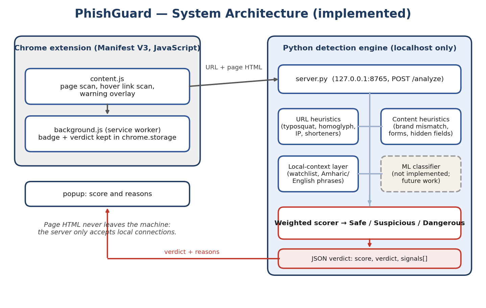
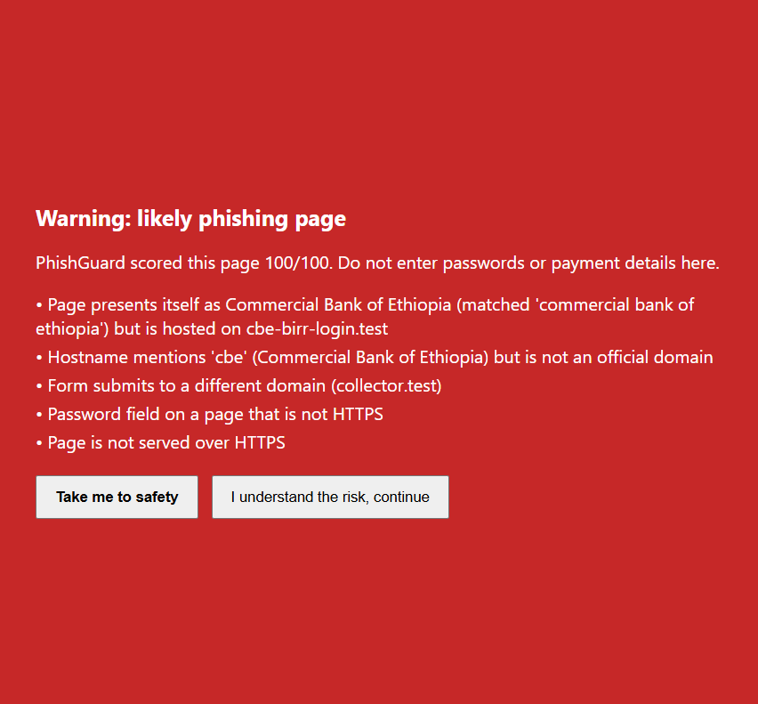
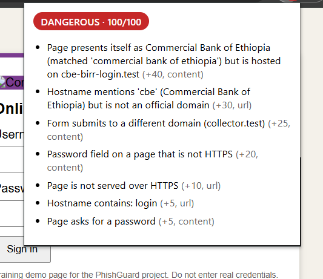
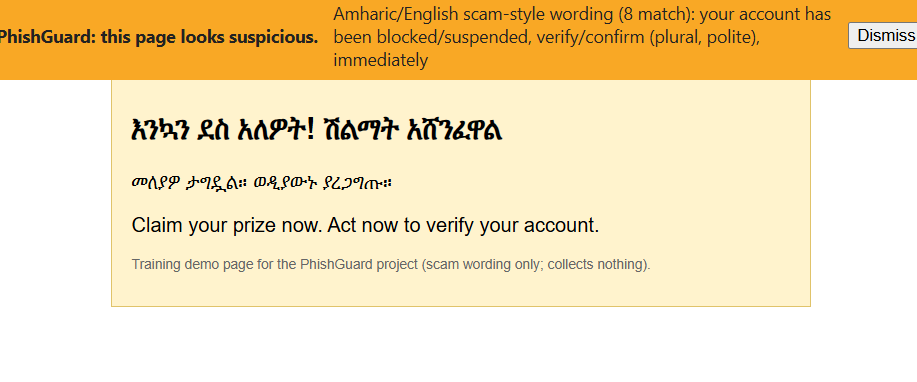
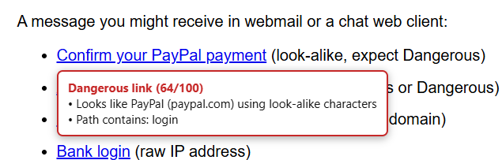
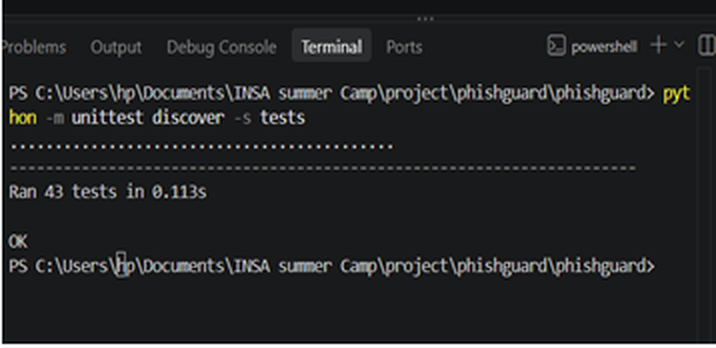
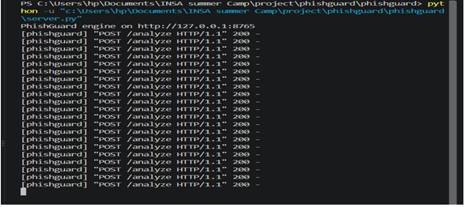

<p align="center"></p>

# PhishGuard

**A Chrome extension with a Python detection engine for real-time, locally aware phishing detection.**
Graduation project, INSA Cybersecurity Training Program. Author: Addisu.

PhishGuard checks the page you are on and the links you hover over, explains every warning, and adds a
**local-context layer** for Ethiopian institutions (banks, telebirr / M-PESA, government portals) and
**Amharic scam wording**. Page data never leaves your computer: the engine is a small server that listens only on `127.0.0.1`.

> Full technical report: [`docs/PhishGuard_Full_Report_v2.pdf`](docs/PhishGuard_Full_Report_v2.pdf) (also as `.docx`).

## What it detects

| Layer | Examples of signals |
|---|---|
| URL heuristics | look-alike (homoglyph) and typosquatted domains, brand name inside another domain, raw IP hosts, shorteners, risky domain endings, free-hosting subdomains, mixed-script domains |
| Page content | brand/domain mismatch, forms posting to another domain, hidden fields, password over HTTP, link text that differs from its destination, a local bank named repeatedly on a login page |
| Local context | watchlist of Ethiopian institutions, Amharic and English scam phrases (threat, urgency, prize, bonus) |
| Pre-click scanning | hover over a link to see a verdict before clicking |

Every signal adds weighted points; the score maps to **Safe** (below 20), **Suspicious** (20 to 59) or **Dangerous** (60+).
The popup lists each signal that fired, so every verdict is explainable.



## Screenshots

| Dangerous warning | Popup with signals |
|---|---|
|  |  |

| Suspicious banner (Amharic scam wording) | Pre-click link tooltip |
|---|---|
|  |  |

| 43 automated tests passing | Engine log during the demo |
|---|---|
|  |  |

## Quick start (Windows, Python 3.9+, no extra packages)

```powershell
git clone <this repository>
cd PhishGuard

python -m unittest discover -s tests     # 43 tests
python server.py                         # engine on http://127.0.0.1:8765
```

1. Chrome: `chrome://extensions` > turn on **Developer mode** > **Load unpacked** > select the `extension` folder.
2. Pin the PhishGuard shield. Open any site: a Safe result appears in the popup.
3. Demonstration pages (harmless training pages, nothing is stored): see [`demo/README.md`](demo/README.md).

## Results

Measured on 26 October 2026. Flagged means score 20 or higher. URL-only evaluation.

| Test | Detection | False positives | Precision |
|---|---|---|---|
| PhishTank (500 verified phishing URLs) vs Tranco (500 popular sites), seed 1 | 12.6% | 0.0% | 100% |
| Same, seed 2 | 14.2% | 0.2% | 98.6% |
| Local-brand set (117 generated look-alikes of Ethiopian institutions), local layer ON | 100% | 0 of 9 official sites | 100% |
| Same set, local layer OFF | 7.7% | 0 of 9 | 100% |

How to read this honestly:

- On **general phishing**, a URL-only check detects little (12 to 14%), because most phishing in the feed imitates brands outside the watchlist or uses new random-looking domains and legitimate hosting. False positives stay very low.
- The tool is strong on **local-brand impersonation**, but that test set is *generated* from the same tricks the detector looks for, and its rules were corrected after the first run on it. It shows design coverage, not independent accuracy.
- The page-content layer is verified by unit tests and demo pages, not on a large sample of real pages.
- Not covered: SMS, voice calls, USSD and native apps (important channels in Ethiopia).

Run the evaluation yourself (datasets are not included; download them and put the CSV files next to `evaluate.py`):

```powershell
python evaluate.py --phishtank-csv verified_online.csv --tranco-csv top-1m.csv --n 500 --seed 1 --sweep
python eval/make_local_set.py
python evaluate.py --phish eval/local_phish.txt --benign eval/local_benign.txt
python evaluate.py --phish eval/local_phish.txt --benign eval/local_benign.txt --no-local
```

Data sources: [PhishTank](https://phishtank.org) verified-online feed, [Tranco](https://tranco-list.eu) top-sites list.

## Project layout

```
engine/        detection logic (url_heuristics, content_heuristics, local_context, scorer) and watchlist
server.py      local API used by the extension
extension/     Chrome Manifest V3 extension (content script, service worker, popup, icons)
demo/          harmless training pages and a tiny demo server
eval/          evaluation sample files and the local-brand test-set generator
tests/         43 automated tests
tools/         icon generator
docs/          technical report, architecture figure, screenshots
```

## Ethics and safety

PhishGuard is a defensive tool. The demo pages are harmless training pages: the "collector" discards form data and stores nothing.
Do not use real credentials on them. Evaluation uses public URL lists only; live phishing pages are never fetched.

## Limitations and future work

Rule-based with hand-set weights; no trained model yet. Chrome only; the engine must be running locally.
The Dangerous warning is shown after the page loads. Future work: a trained URL classifier, following redirects,
real reported Ethiopian phishing samples, collecting more Amharic scam messages, and packaging the engine so no separate server is needed.

## License

MIT. See [`LICENSE`](LICENSE).
